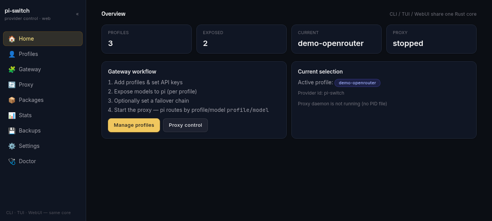
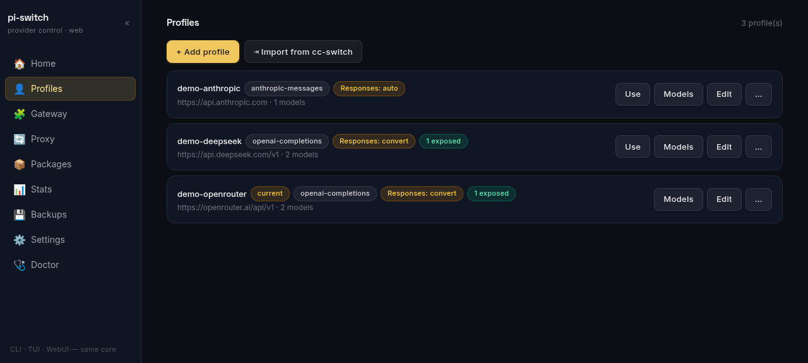
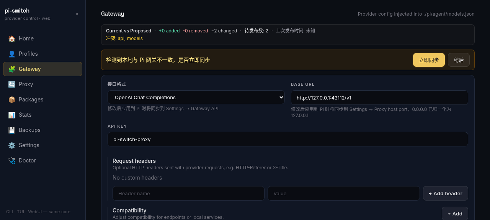
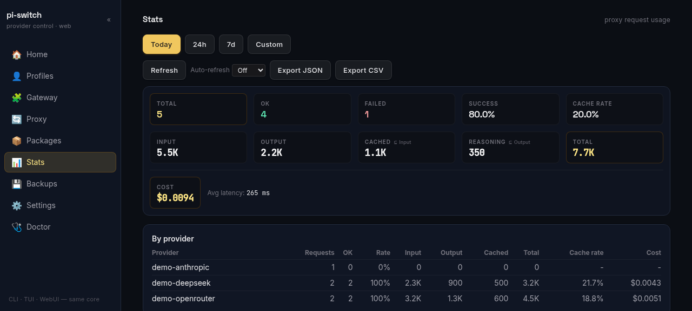

# pi-switch

**面向 pi agent、以 Native Desktop 为主，并提供 Linux CLI 与 TUI 的控制面板。**

管理 provider 配置并发布本地模型名网关。Native Desktop 是主要 GUI；旧 WebView 暂通过 Desktop `--web` 回退入口保留。

[English](README.md) | [中文](#)

---

## 旧 WebView 截图（Desktop `--web` 回退）

 

---

## 功能简介

- 管理 provider 配置、模型列表和各渠道暴露的模型。
- 在 Gateway 页面预览并发布模型到 Pi。
- 通过本地代理按模型名路由请求。
- 在 Native Desktop 或旧 WebView 中查看请求与 token 用量，并管理 pi packages。
- Native Desktop、CLI、TUI 与管理 API 共用同一套 Go 核心。

架构与详细行为见 [WebUI 指南](./WEBUI_GUIDE.md)、[后端架构](./docs/architecture.md) 和[系统契约](./docs/system-contract.md)。

## 安装

### 通过 npm 安装

~~~bash
npm install -g @heihei0299/pi-switch

# 或通过 pi 安装
pi install npm:@heihei0299/pi-switch
~~~

### 从源码构建

需要 Node.js 23.6 或更高版本，以及 Go 1.24.2 或更高版本。

~~~bash
git clone https://github.com/heihei0299/pi-switch.git
cd pi-switch
npm install
npm run build
node bin/pi-switch.js webui start --daemon
~~~

新版本 CLI/npm 仅支持 Linux amd64 和 arm64；macOS、Windows 不再支持，历史版本保持不变。可在 [Releases](https://github.com/heihei0299/pi-switch/releases) 查看可下载版本。

## 快速开始

启动 HTTP 管理 API（`webui` 是保留的历史命令名；此命令不再提供浏览器界面）：

~~~bash
pi-switch webui start --daemon
~~~

管理 API 仍位于 `/api/*`，根路径 `/` 会显示 WebUI 退役说明。正式 GUI 门禁与弃用步骤完成前，Desktop `--web` 回退仍保留。运行 <code>pi-switch doctor</code> 检查环境，用 <code>pi-switch webui stop</code> 停止 API；也可以使用终端界面 <code>pi-switch tui</code> 或其他 CLI 命令。

### 在 Pi 中使用模型

1. 在 **Profiles** 中添加 provider 并暴露模型。
2. 在 **Gateway** 中检查变更，然后选择 **Apply to Pi**。
3. 在 **Proxy** 中启动代理，或运行 <code>pi-switch proxy start --daemon</code>。
4. 在 Pi 中，Responses 模型选择 <code>pi-switch-res</code>，Chat 模型选择 <code>pi-switch-chat</code>，然后选择已暴露的模型。

管理 API 默认绑定 loopback。绑定非 loopback 地址需要密码，详见[安全说明](./WEBUI_GUIDE.md#security)。

## 常见问题

**如何在 Pi 中切换模型？**

打开 <code>/model</code>，选择已发布的 <code>pi-switch-res</code> 或 <code>pi-switch-chat</code> provider，再选择已暴露的模型。

**数据存放在哪里？**

配置和本地请求数据存放在 <code>~/.pi-switch/</code>。Pi 的 provider 注册表位于 <code>~/.pi/agent/models.json</code>。

## 开发

需要 Node.js 23.6 或更高版本，以及 Go 1.24.2 或更高版本。

~~~bash
npm install
npm run build
bash scripts/test-limited.sh
npm run test:webui
~~~

## 致谢

- 感谢 [cc-switch](https://github.com/farion1231/cc-switch) 和 [cc-switch-cli](https://github.com/SaladDay/cc-switch-cli) 带来的配置管理与终端界面思路。
- 感谢 [LINUX DO](https://linux.do/) 社区的讨论与启发。

## 许可证

MIT
