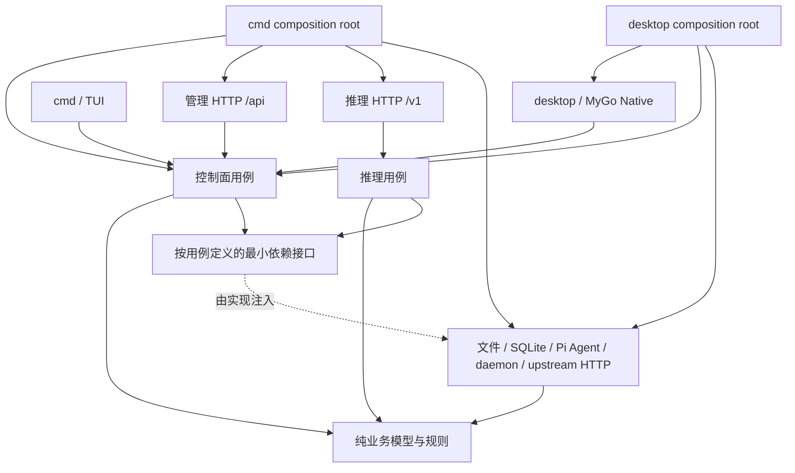

# pi-switch Architecture V2 — 模块化单体重构规范

- 状态：实施基线（W20–W25 已在本地分支完成；W26 实机门禁独立处理）
- 日期：2026-10-14
- 对照代码：当前 `codex/mygo-v2-20261014094522` 分支的 W20–W25 提交
- 设计性质：内部模块化重构，外部行为优先保持兼容
- 目标平台：Linux amd64 / arm64；Desktop 为 MyGo Native；CLI、TUI、管理 API、独立 Proxy 保留

## 1. 现状与问题陈述

当前系统以 Go 单体为核心，入口包括 `cmd/pi-switch` CLI/TUI、`desktop` 独立 Go module 的 MyGo Native，以及 `internal/server` 提供的管理 API 和推理 API。重要事实所有权明确：`config.json` 定义供应商/渠道/模型，`models.json` 是显式发布的 Pi Gateway 视图，SQLite 保存请求事实，Pi session 只读。V2 的新 domain/usecase/adapter 目录已经接管 Gateway、Analytics、Proxy 响应和 RequestLog 的对应职责；旧包仅作为兼容入口或尚未迁移的实现保留。

历史问题与当前状态：

1. Provider、Gateway、Packages、Settings 等仍保留历史入口差异；兼容性优先，后续迁移必须分别保留各 endpoint 的旧合同。
2. Desktop Shell 仍承担窗口、托盘、daemon 和任务协调；这是 UI 组织问题，不在 W25 继续扩张业务边界。
3. `internal/server` 仍是兼容 HTTP 入口；W22 已将客户端响应/SSE 写入移到 `internal/adapters/inbound/httpinfer`，W23 已将新请求的双写协调移到 `internal/usecase/requestlog`。
4. `internal/config`、`internal/gateway`、`internal/protocol`、`internal/store` 等兼容包仍存在；历史文档中的 `internal/translator`、`internal/limit`、`internal/daemon` 路径已分别落到 `internal/domain/protocol`、`internal/domain/limit`、`internal/adapters/outbound/daemon`，不再作为当前路径。

## 2. 架构选择

采用 **模块化单体（Modular Monolith）+ 业务纵向切片 + 轻量 Ports & Adapters**。

说明：模块化首先体现在明确的 Go package import DAG 与用例所有权，并不要求给每个类型创建 interface、DTO、Repository 或微服务；对于只被一个调用方使用的代码可保留具体类型。遵循 Go 官方「尽量使用 internal 包、接口定义在消费者侧、实现者返回具体类型」的习惯。

保留：
- Go 作为唯一后端核心，无 Rust 复活。
- MyGo 原生 GUI，不引入 WebView、React 或 HTTP loopback 作为 GUI 内部业务通道。
- CLI/TUI/API 同属一个产品，受共享业务规则约束。
- 独立 Proxy 进程，GUI 退出不停止它。
- 两个既有 Go 模块：根模块 `go 1.24.2`、`desktop` 模块 `go 1.27.1`。不因为目录整洁盲目合并。

不采用：微服务、事件总线、全局 Service Locator、泛型 CRUD/Repository 框架、动态插件内核、全面 ORM、重新设计存储格式。

## 3. 目标组件与调用方向



**强制规则：**

- `domain`：只能依赖标准库及其他明确允许的纯 domain 规则；不读取环境、磁盘、网络、MyGo、Gin 或 daemon。
- `usecase`：封装单一产品行为、事务边界、验证及结果语义；依赖 domain 和本包消费侧定义的小接口；不得依赖 Gin、MyGo、CLI 命令、具体数据库或具体文件实现。
- `adapters/inbound`：把 HTTP/Native/CLI 输入转换为用例命令，将用例结果映射到各入口的既有格式；不直接写业务持久化文件。
- `adapters/outbound`：实现存储、进程与远端接口，承担原子写、文件锁、权限、连接池等技术行为；不含业务路由或 UX 状态。
- `bootstrap`：由每个可执行入口（`cmd`、`desktop`）分别充当 composition root，允许同时认识具体 adapter 与 usecase；根模块可提供不依赖 Desktop/MyGo 的共享装配辅助函数，但根模块绝不 import `desktop`（否则会引入两个 Go module 的依赖环）。采用显式构造函数注入，不使用全局注册表。
- 当一项功能迁移到 V2 后，其入口禁止绕过用例层直接写数据；尚未迁移的旧调用允许在对应工单范围内存在，禁止新增同类直通路径。
- 共享的类型只进入实际使用它的业务模块；避免无限生长的 `common`、`utils`、`types` 包。
- 本设计描述最终依赖方向，不要求在第一工单移动全部原有 packages。先添加新组件，迁移用例，最后清理旧包。

**静态依赖规则（`go run ./internal/archcheck`，CI 持续执行）：**

一次 checker 运行从仓库根目录读取根模块和 `desktop/go.mod`，分别扫描两个 Go Module；Desktop 的 composition root 文件可以依赖根模块的共享业务与基础设施包，但两个模块各自的 `internal/domain/**` 和 `internal/usecase/**` 仍按下表独立约束。

| 生产代码位置 | 可依赖的本仓库包 | 其他依赖 |
|---|---|---|
| `internal/domain/**` | `internal/domain/**` | 仅标准库 |
| `internal/usecase/**` | `internal/domain/**`、`internal/usecase/**` | 仅标准库 |
| `internal/adapters/inbound/**` | `internal/domain/**`、`internal/usecase/**`、本 inbound 子树 | 可用标准库和入口所需外部库；不得依赖 outbound |
| `internal/adapters/outbound/**` | `internal/domain/**`、`internal/usecase/**`、本 outbound 子树 | 可用标准库和 IO 所需外部库；不得依赖 inbound |
| `internal/bootstrap/**` | 可装配各内部包 | 根模块不得依赖独立 `desktop` 模块 |

检查器也对根模块的 `cmd`、`internal`、`legacy`、`webui` 和根目录生产 Go 源拒绝导入 `desktop`；Desktop 模块则扫描其根目录、`internal` 等生产源，但不把 Desktop 的 composition root 误判为 domain/usecase。两个模块中的 domain/usecase 都拒绝外部库、adapter、store、config、daemon 等具体基础设施包；标准库工具包和同层/下层业务包仍按上表允许。它只检查生产 `.go` 文件，不把测试夹具的跨层导入当成产品依赖。`internal/usecase/requestlog` 另有负例规则：不得导入 `database/sql`、`internal/store`、`internal/config` 或 `internal/server`；SQLite/Legacy 文件实现只能在 `internal/adapters/outbound/requestlog`。W22 的 `httpinfer` 与 outbound 互斥、W23 的 RequestLog 限制均由 `internal/archcheck/main_test.go` 的负例覆盖。

## 4. 按业务能力划分的目标包

**逻辑目标**（目录是建议的演进结果，允许在迁移过程中临时兼容包）：

```text
cmd/pi-switch/                     CLI / TUI / daemon 程序装配
desktop/                         MyGo 单独 Go module；页面 + presentation + 交互任务
internal/
  domain/
    provider/                     Provider/Channel/Model 规则与值对象
    gateway/                      纯 canonical plan、验证、diff、merge
    protocol/                     API 能力、协议判定与限制
    catalog/                      模型快照解析、查找与元数据补齐规则
    usage/                        Token/Cost 事实计算
    conversation/                 归属匹配规则
  usecase/
    providers/                    Draft / CRUD / 模型抓取 / 测试 / 版本冲突
    gateway/                      Preview / Catalog enrich / Validate / Explicit Publish
    settings/                     设置、备份与恢复
    analytics/                    Stats / Sessions / Export
    packages/                     包列表、导入、修改
    proxycontrol/                 启停/状态/健康信息（不承载推理）
    inference/                    Request routing / conversion / stream coordination
    requestlog/                   请求事实双写协调，不依赖具体存储
  adapters/
    inbound/httpinfer/            OpenAI-compatible /v1 客户端响应与 SSE 适配
    outbound/fileconfig/          config.json 锁、版本、备份、原子写
    outbound/filegateway/         models.json 锁、快照校验、原子 publish
    outbound/catalog/             models.dev 拉取与缓存读写
    outbound/requestlog/          SQLite INSERT 与 Legacy requests.log 追加
    outbound/sqlanalytics/        SQLite Stats / Conversations 查询
    outbound/sqlpackages/         SQLite packages 查询
    outbound/proxy/               上游网络请求、header 和请求构造
    outbound/piagentpackages/     只读 Session/包探测
    outbound/daemon/               PID、进程身份、启停
  bootstrap/                       根模块内通用装配帮助（不可 import desktop）
```

现有 `internal/config`、`internal/gateway`、`internal/protocol`、`internal/store` 等继续作为可工作的兼容接口或底层旧实现；历史 `translator`、`limit`、`daemon` 名称不代表当前目录。V2 新代码使用上表中的 domain/usecase/adapter 路径。禁止一次 PR 重命名全部包而无法识别行为变化。

## 5. 业务上下文合同

### 5.1 Providers 与配置

- `config.json` 是唯一事实来源；保持原 JSON 字段、缺省/`null`/`[]`、migration、legacy 兼容及 `PI_SWITCH_CONFIG` 优先级。
- 所有写入最终使用同一跨进程锁、读最新值、校验、原子保存的机制；迁移时保留保存前备份和 revision 验证的既有入口语义。
- `ProviderCommands` 统一命令和错误分类，而不是统一一切 endpoint 的保存策略。为 Native 交互式保存与历史 HTTP PUT 分别定义显式用例入口，内部复用验证和 mutation engine。旧 HTTP 的覆盖与错误码行为不得在未批准时被静默改变。
- 原始凭证只保留在内存和必要文件中；草稿只显示掩码，日志/HTTP 错误不得泄露密钥或 URL 密码。

### 5.2 Gateway

- 将 plan 纯计算（Build/Validate/Diff/Merge）与持久化（读取 current、持锁发布、同步目录、原子替换）分开。
- `BuildGenerated` 使用 catalog FillOverwrite；显式 Draft 使用 FillMissing：`cost` 等按键存在判断（明确写出的零价格保留），而 `contextWindow`/`maxTokens` 的 `0` 与空 `input` 数组按当前业务合同视为未声明，可由 catalog 补齐；其他显式 draft 元数据不被覆盖。
- `models.json` 仅可在显式发布后写入；冲突、取消、无变化都零写入；不得修改 `config.json`。
- 第三方 providers 保留；验证冲突阻止发布；快照过期禁止覆盖；最终文件权限 `0600`。

### 5.3 Proxy / Inference

- 代理请求链由 `internal/server`、`internal/usecase/inference`、`internal/adapters/outbound/proxy` 和 `internal/adapters/inbound/httpinfer` 协作完成：`Decode → Route → Validate/Clamp → Protocol Plan → Outbound → Response/Stream → Usage/Cost → RequestLog`。
- 统一流式与非流式共享的 **路由选择、上游请求构造、事实归一化**；流式转换独立实现，避免为了复用而牺牲 SSE backpressure、flush 和错误语义。
- outbound proxy 只访问上游，不持有客户端 `http.ResponseWriter`；客户端 status/header/body/SSE/flush 由 inbound `httpinfer` 适配。
- 保留 `/v1/*` 路径、状态码、错误 envelope、模型裸 ID、失败时记录事实、工具调用和多轮历史、取消与限额规则。
- 入站 context 显式贯穿 outbound 请求、数据库查询等可取消工作；不可将 `Context` 长期保存在 service struct 中。已经开始且必须提交的文件/进程副作用，需要明确提交点，不因 UI 退出声称已回滚。
- Proxy 是独立 daemon，启动/停止必须验证进程身份与健康，不得接管未验证监听者。

### 5.4 Analytics / Stats / Sessions

- `internal/usecase/analytics` 定义统计、会话和分页语义；`internal/adapters/outbound/sqlanalytics` 只负责 SQLite 查询与 NULL/分页边界。
- 请求表始终保存不可变事实；由业务层聚合、展示时匹配会话，不修改原 row。
- 统一查询语义；在不改变计费、unknown、cache、reasoning 和会话匹配意义的前提下减少重复扫描。
- 性能优化先建立 1 万 / 10 万 / 100 万请求数据集的可重复 benchmark；保留旧输出作为 golden baseline。
- 不强制引入 ORM；SQL 查询下沉到 SQLite adapter，独立验证分页、时间窗口和索引。

### 5.5 RequestLog / Legacy Log

- `internal/usecase/requestlog` 只协调 `Record` 事实向两个最小 port 写入；不得导入 `database/sql`、`internal/store`、`internal/config` 或 `internal/server`。
- `internal/adapters/outbound/requestlog` 实现 SQLite INSERT 和 Legacy `requests.log` 追加；两个目标独立失败，保持既有客户端响应语义。
- `internal/server/legacy_log.go` 只保留旧日志历史导入兼容逻辑，不是新请求的文件写入 owner。

### 5.6 Packages / Settings / Daemon

- Packages 命令通过单一用例入口调用原有服务/SQLite；接口 DTO 尽可能类型化，旧 HTTP JSON 序列化兼容。
- Settings 与备份、恢复仍遵循既有 path/revision/permissions 合同。
- Daemon 为适配器：pidfd 身份、运行状态、重启/停止安全是不可变约束；GUI 的隐藏/退出不触发隐式 Proxy stop。

## 6. 代码组织与类型设计规范

1. 业务用例公开方法有明确输入/输出命令与结果类型；通常 `func (s *Service) Execute(ctx context.Context, cmd Command) (Result, error)`。
2. 只有当某个用例需要替换外部资源时，才在 **消费者包** 声明 1～3 个方法的最小接口。实现方返回具体类型。禁止全局 `Repository` 大接口。
3. UI 存储局部 `State`，控制器接收用例结果，Shell 只管理窗口/导航/任务协调/托盘。跨页只通过明确的协作方法，而不是写别的页面内存字段。
4. Handler 只解码、认证/鉴权、调用用例、编码错误；不含文件写入闭包或业务计算。HTTP 错误 envelope 维持管理面字符串和推理面 OpenAI 对象两种格式。
5. CLI 与 TUI 同样是 inbound adapter。`cmd/pi-switch/main.go` 与 `desktop/main.go` 各自完成组合根装配；根模块 bootstrap 不 import 独立的 desktop 模块。
6. 对 `map[string]interface{}`：只用于确实动态的 OpenAI/Anthropic 协议和 Gateway JSON 边界；内部稳定 DTO 采用类型化结构。
7. context 首参传递于 I/O 链；对副作用区分「尚未开始、已提交、已完成」，不可为追求统一取消而放松文件一致性。
8. 仅保留受消费者实际需要的接口；不为满足某种 Clean Architecture 模板而增加无意义中间层。
9. 对非导出业务包倾向 `internal`。Go package import 必须单向且无循环；新增能力优先纵向切片，不在横向超大文件追加逻辑。
10. 原有两模块工具链可独立编译；暂不提高 Go 最低版本、不新增默认运行依赖。

## 7. 非功能目标与验收门

- **兼容性：** 保持 CLI 命令/退出码、`/api/*` 和 `/v1/*`、错误信封、JSON/SQLite 格式、环境变量、包身份、Linux amd64/arm64 分发。
- **数据完整性：** 配置写入锁、旧版本可读取、无隐式 Gateway 发布、异常退出不会把文件写成半截、第三方 provider 保留。
- **安全：** 不输出凭证、不将敏感数据写入默认日志、保持 Proxy 进程校验/Basic Auth 边界。
- **职责：** 当模块被迁移，UI/HTTP 不再直接执行该领域持久化，usecase 不 import Gin/MyGo/adapter；自动化依赖规则持续运行。
- **测试：** 每一工单单独包含对应目标层的单元测试，以及至少一条旧行为与新行为的等价 fixture；生产代码变更后运行根/desktop 相关 `go test`、`go vet`，最终全量 + 现有功能 smoke。
- **性能：** 在先后同环境可复现的 benchmark 上比较 Stats、Proxy 请求与内存使用，具体阈值以基线为准，禁止无基线宣称优化百分比。
- **可回滚：** 新包逐步接管调用路径；移除旧函数/旧文件只能在所有消费者已迁移、相关测试通过之后。
- **GUI：** 本轮自动化 tester/打包验证不替代下一阶段 Arch+niri/Wayland/IME/Scale 2 实机验收。

## 8. W20–W26 实施状态

| 工单 | 当前状态 | 实际结果 |
|---|---|---|
| W20 | 已完成 | Root CI 的 `main`/`mygo` push 触发；Tag 才能进入发布链；未 Push，因此远程运行结果未验证 |
| W21 | 已完成 | Analytics 分页极值防护；Usecase、HTTP handler 和 SQLite 分页边界测试通过 |
| W22 | 已完成 | 客户端响应/SSE 适配迁移到 `internal/adapters/inbound/httpinfer`；outbound proxy 不再写客户端响应 |
| W23 | 已完成 | RequestLog usecase、SQLite/Legacy outbound adapter 和 bootstrap 装配完成；历史导入保留 |
| W24 | 已完成 | Analytics 聚合使用轻量 `AggregationFact`；1M shared-window benchmark 的 B/op 达到既定下降目标 |
| W25 | 当前工单 | 文档与 archcheck 对齐实际目录，并补充 inbound/outbound/RequestLog 依赖负例 |
| W26 | 未在本规范中宣称通过 | Arch+niri/Wayland/Noctalia/Fcitx5/MyGo Native 的真实图形会话验收必须另行取得证据；Xvfb 或模拟 GUI 不算通过 |

每个工单保持独立本地 commit；commit 不等于 push/merge/release。未授权不得更新远程分支或 live 数据。

## 9. 参考

- 当前代码架构：`docs/architecture.md`、`docs/system-contract.md`、`docs/adr/*`
- Go 模块组织：https://go.dev/doc/modules/layout
- Go 接口设计：https://go.dev/wiki/CodeReviewComments#interfaces
- Context / cancellation：https://go.dev/blog/context ; https://go.dev/doc/database/cancel-operations
